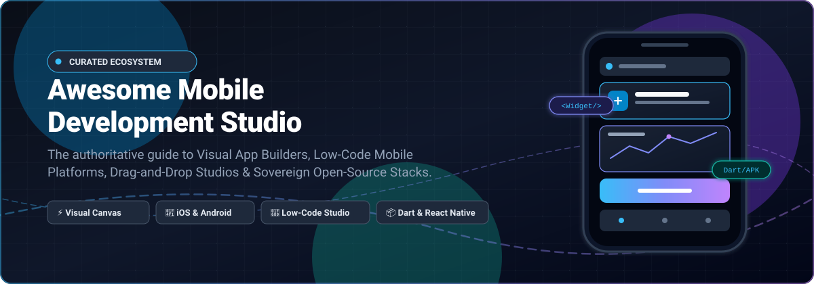
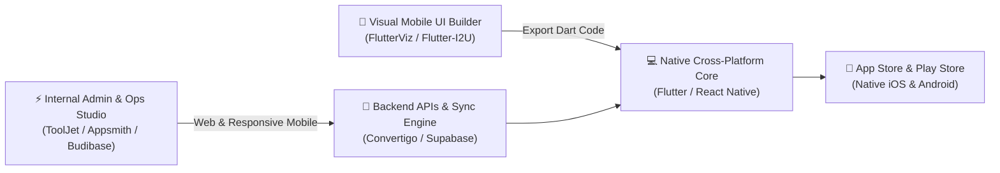

# 📱 Awesome Mobile Development Studio

### 🚀 Curated Directory of Visual App Builders, Low-Code Mobile Platforms & Sovereign Open-Source Stacks

  
  
  
  
  
  
  

**A production-tested index of tools for visual mobile app authoring, drag-and-drop UI engineering, logic workflows, and code export for native iOS, Android, Flutter, and React Native applications.**

---

## 📑 Table of Contents

- [🔍 Overview & SEO Highlights](#-overview--seo-highlights)
- [🌐 Sector Overview & Market Dynamics](#-sector-overview--market-dynamics)
- [🏢 SaaS & Hosted Platforms](#-saas--hosted-platforms)
- [🔓 Open-Source GitHub Projects](#-open-source-github-projects)
- [🏗️ Recommended Architectural Patterns](#️-recommended-architectural-patterns)
- [🤝 How to Contribute](#-how-to-contribute)
- [💖 Support & Sponsorship](#-support--sponsorship)
- [📈 Star History](#-star-history)
- [⚖️ Disclaimer & License](#️-disclaimer--license)

---

## 🔍 Overview & SEO Highlights

**Mobile Development Studios** encompass integrated development environments (IDEs), visual canvases, and low-code/no-code platforms that dramatically compress the development lifecycle for cross-platform mobile apps. Whether generating production-grade **Flutter (Dart)** code, **React Native (TypeScript)** components, or deploying enterprise workflow engines, these studios empower digital product teams, citizen developers, and engineering leads to ship high-performance native apps without manual boilerplate.

### 🎯 Key Evaluation Pillars
- 🎨 **Visual Drag-and-Drop Canvas:** Pixel-accurate layout editing, responsive breakpoints, and pre-built design systems.
- ⚡ **Logic & Workflow Orchestration:** Visual condition builders, state management machines, and trigger-action pipelines.
- 📦 **Code Ownership & Portability:** Full clean code export (Flutter/Dart, React Native, Swift, Kotlin) preventing vendor lock-in.
- 🔌 **Data Integration & Offline Caching:** Native SQLite, REST, GraphQL, Firebase, and enterprise connectors.
- 🛡️ **Deployment Sovereignty:** Self-hosted open-source stacks vs. managed SaaS cloud services.

*Tags: `#mobile-development` `#app-builder` `#low-code` `#no-code` `#ui-builder` `#flutter` `#react-native` `#ios` `#android` `#developer-tools`*

---

## 🌐 Sector Overview & Market Dynamics

> 📊 **Estimated Market Size**: The global Mobile Application Development Platform (MADP) and Low-Code Development Platform market was estimated at **$28.5 Billion in 2024** and is projected to reach **$118.7 Billion by 2032**, expanding at a rapid compound annual growth rate (**CAGR of ~22.8%**).

> ⚖️ **Market Structure & Dynamics**: The sector is **moderately fragmented** characterized by a dual-tier competitive structure rather than a singular winner-take-all outcome:
> 1. **Enterprise Systems of Record**: Large cloud and IT conglomerates (*Google AppSheet, ServiceNow, Siemens Mendix, OutSystems*) dominate Fortune 500 workflow digitization, governance, and internal systems with high contract values and deep ERP/CRM lock-in.
> 2. **Modern Developer-Centric Visual Studios**: Nimble innovators (*FlutterFlow, Glide, Draftbit, Thunkable*) capture the creator, startup, and digital agency economy by emphasizing modern open source frameworks (Flutter, React Native), instantaneous code export, and sleek user experience.
> 3. **Open-Source & Self-Hosted Sovereignty**: Because enterprise SaaS costs scale steeply per-seat, high-velocity open-source platforms (*ToolJet, Appsmith, Budibase, Convertigo*) command enormous community adoption for privacy-conscious organizations demanding on-premise execution and zero licensing penalties.

---

## 🏢 SaaS & Hosted Platforms

The following hosted mobile studios are sorted in **descending order by company size** (market capitalization, parent revenue, or latest institutional valuation).

| 🏢 Platform / Studio | 📊 Company Size (Valuation / Revenue) | 🎯 Primary Focus & Strengths | 💰 Starting Pricing | 🎁 Free Tier & Trial Limits |
| :--- | :--- | :--- | :--- | :--- |
| **[Google AppSheet](https://www.appsheet.com/)** | **~$2.1T+ Market Cap** *(Alphabet Inc. / $307B+ Rev)* | No-code mobile and tablet apps built directly on Google Workspace, Sheets, BigQuery, and SQL data sources. | **$5 / user / month** *(Starter plan; or $50/app/mo Publisher Pro)* | **Free forever for prototypes**: Up to 10 test users per app; unlimited draft apps; personal-use apps capped at 3 users; automated external email/push triggers disabled until upgrade. |
| **[ServiceNow Mobile Studio](https://www.servicenow.com/)** | **~$190B Market Cap** *(NYSE: NOW / $10.5B+ Rev)* | Enterprise native mobile workflow creation within the Now Platform; offline-first field service & employee experiences. | **~$50 / user / month** *(Fulfiller license via App Engine contracts)* | **Free Personal Developer Instance (PDI)**: Full access to Mobile App Builder & App Engine Studio; non-commercial dev sandbox only; reclaimed if inactive for 10 consecutive days. |
| **[Mendix](https://www.mendix.com/)** | **~$150B Market Cap** *(Siemens AG / $730M acquisition)* | High-productivity visual modeling IDE (Studio Pro) for native offline-capable mobile and enterprise portal applications. | **€900 / month** *(Standard single-app tier, billed annually)* | **Free Edition forever**: Unlimited app creation in Mendix Studio Pro desktop IDE; free cloud deployment node with auto-sleep after 1 hr inactivity; capped at 5 concurrent users; no custom domain. |
| **[OutSystems](https://www.outsystems.com/)** | **~$9.5B Valuation** *(Private Unicorn / $300M+ ARR)* | Enterprise-grade full-stack low-code engine with visual logic modeling, one-click mobile compilation, and DevOps pipelines. | **$3,025 / month** *($36,300 / yr for ODC Professional tier)* | **Free Personal Edition forever**: Up to 100 internal end-users; 1 GB to 2 GB cloud database storage; max 3 concurrent active apps/agents; sandbox development only with no production SLA. |
| **[Appery.io](https://appery.io/)** | **~$300M+ PE Valuation** *(Exadel / Sun Capital Partners)* | Visual browser-based drag-and-drop mobile IDE with integrated backend services, push notification engines, and API bridges. | **$25 / month** *(Beginners plan billed monthly)* | **14-day free trial**: Access to full Pro plan features with visual builder; restricted to 1 developer seat; community forum support only; app backup snapshots disabled during trial. |
| **[FlutterFlow](https://flutterflow.io/)** | **~$170M Valuation** *(Series A / $25M+ ARR)* | Visual Flutter application studio generating production-grade Dart code with Firebase/Supabase integrations and animations. | **$39 / month** *(Basic plan; or $30/mo billed annually)* | **Free forever**: Up to 2 active projects; 2 API endpoints per project; 5 lifetime AI requests; web preview on `flutterflow.app` subdomain; 1 editor; code export and APK downloads disabled. |
| **[Glide](https://www.glideapps.com/)** | **~$150M Valuation** *(Series A Benchmark / $15M+ ARR)* | AI-assisted no-code platform converting spreadsheet rows, Airtable, and SQL into responsive mobile applications. | **$25 / month** *(Explorer plan; or $19/mo billed annually)* | **Free forever**: Up to 10 personal users; 25,000 rows in Glide Tables; 1 editor seat; builder testing sandbox only (0 published apps; cannot share live external apps without upgrading). |
| **[Thunkable](https://thunkable.com/)** | **~$100M Valuation** *(Series B / $10M+ ARR)* | Block-based visual mobile programming environment compiling directly to native iOS and Android binaries. | **$19 / month** *(Accelerator; $59/mo Builder to publish)* | **Free forever**: Up to 3 public community projects; max 5 screens per project; 100 MB account storage; testing limited to Thunkable Live companion mobile app; 0 app store publishes. |
| **[BuildFire](https://buildfire.com/)** | **~$45M Valuation** *(Bootstrapped / $15M+ ARR)* | Modular mobile app building platform featuring a large plugin marketplace, loyalty tools, and push notification infrastructure. | **$165 / month** *(Standard plan; or $139/mo billed annually)* | **14-day free trial**: Full access to visual builder dashboard and core plugin templates; 1 admin seat; preview testing on companion app; live App Store/Play Store deployment requires paid plan. |
| **[Draftbit](https://draftbit.com/)** | **~$25M Valuation** *(Seed-stage YC / $3M+ ARR)* | Visual developer-focused studio producing unopinionated React Native source code with full GitHub sync and custom components. | **$15 / month** *(Standard plan; or $12/mo billed annually)* | **Free forever**: Up to 3 projects (1 open project active at a time); 1 editor seat; web preview on `draftbit.dev` subdomain; 3,000 one-time AI credits; source code ZIP/GitHub export disabled. |

---

## 🔓 Open-Source GitHub Projects

The following open-source visual app builders, low-code platforms, and mobile development studios are sorted in **descending order by GitHub star count**.

| 🌟 Open-Source Repository | 🏷️ License | 📱 Mobile & Visual Capabilities | 💻 Primary Tech Stack |
| :--- | :--- | :--- | :--- |
| **[ToolJet](https://github.com/ToolJet/ToolJet)**  | `AGPL-3.0` | Comprehensive low-code framework featuring a dedicated responsive canvas with mobile view layout switcher, 50+ UI widgets, and custom JS plugins. | TypeScript, React, Node.js |
| **[Appsmith](https://github.com/appsmithorg/appsmith)**  | `Apache-2.0` | Drag-and-drop internal tool builder supporting auto-adjusting mobile canvas viewports, custom widgets, and instant database/REST connectivity. | TypeScript, React, Java |
| **[Budibase](https://github.com/budibase/budibase)**  | `AGPL-3.0` | High-performance open-source low-code platform for building business apps, forms, and client portals optimized for mobile screens. | TypeScript, Svelte, Node.js |
| **[NocoBase](https://github.com/nocobase/nocobase)**  | `AGPL-3.0` | Scalable, plugin-first no-code and low-code development platform providing block-driven page customization and mobile-responsive dashboards. | TypeScript, React, Node.js |
| **[ILLA Cloud](https://github.com/illacloud/illa-builder)**  | `Apache-2.0` | Low-code developer canvas with drag-and-drop UI components, AI Agent integration, and responsive mobile layout modes for agile enterprise tools. | TypeScript, React, Go, Rust |
| **[MIT App Inventor](https://github.com/mit-cml/appinventor-sources)**  | `Apache-2.0` | The foundational open-source visual drag-and-drop mobile IDE. Uses visual block programming to compile native Android (.apk) and iOS (.ipa) applications. | Java, Scheme, Blockly |
| **[Lowcoder](https://github.com/lowcoder-org/lowcoder)**  | `AGPL-3.0` | Open-source low-code development platform to assemble internal applications and mobile tools with custom JavaScript plugins and dynamic data connectors. | TypeScript, React, Java |
| **[Convertigo](https://github.com/convertigo/convertigo)**  | `AGPL-3.0` | Enterprise open-source low-code/no-code mobile studio featuring Convertigo Studio, visual Mobile Builder, Fullsync offline database, and AGPL licensing. | Java, TypeScript, Angular |
| **[FlutterViz](https://github.com/iqonic-design/flutter_viz)**  | `MIT` | Visual UI builder engineered specifically for Flutter with 50+ built-in widgets, real-time styling parameters, and direct export to clean Dart code. | Flutter, Dart |
| **[SketchIDE](https://github.com/sketchide/SketchIDE)**  | `GPL-3.0` | Visual IDE for Android and iOS mobile app creation designed to streamline native application assembly with no code and modular logic nodes. | Kotlin, Java |
| **[Flutter-I2U Studio](https://github.com/Flutter-I2U/studio)**  | `MIT` | Open-source drag-and-drop Flutter UI studio generating clean, readable Flutter code with zero subscriptions, live preview, and full code ownership. | Flutter, Dart |

---

## 🏗️ Recommended Architectural Patterns

When constructing sovereign, scalable mobile development pipelines without expensive per-seat licensing, consider combining these open-source building blocks:

- **Consumer & Public Native Apps**: Use **FlutterFlow** (commercial SaaS) or **FlutterViz** / **Flutter-I2U Studio** (open-source) to design native widget hierarchies and export clean Dart code into your standard CI/CD workflow.
- **Enterprise Operations & Field Service**: Deploy **Convertigo** for offline synchronization and backend transactional connectors, or **ToolJet** / **Appsmith** for mobile-responsive internal tooling.
- **Education & Visual Prototyping**: Utilize **MIT App Inventor** or **Thunkable** for visual block programming and rapid proof-of-concept testing.

---

## 🤝 How to Contribute

Contributions from developers, platform maintainers, and community members are warmly welcomed! 🌟

1. **Fork** this repository.
2. **Create a branch** for your updates (`git checkout -b feature/add-new-studio`).
3. **Add your platform entry** ensuring:
   - For SaaS: Include specific starting tier pricing, specific free tier/trial limits, and company size metrics.
   - For Open-Source: Include the official GitHub repository, an `https://img.shields.io/github/stars/<owner>/<repo>?style=social&color=white` badge linking to stargazers, and place it in correct star-descending order.
4. **Test formatting** to maintain clean Markdown and table alignment.
5. **Submit a Pull Request** with a concise description of the platform's merits.

---

## 💖 Support & Sponsorship

If this curated repository saved you time, helped you evaluate platforms, or supported your engineering decision-making, please consider showing your support:

- ⭐ **Star this repository** to help others discover it across GitHub.
- 🍴 **Fork and contribute** to keep entries accurate and up to date.
- 📢 **Share this list** with fellow mobile engineers, architects, and founders on Discord, Twitter/X, and LinkedIn.
- ☕ **Sponsor the Maintainer**: Support ongoing open-source curation and tool development via the [GitHub Sponsors Dashboard](https://github.com/sponsors/ishandutta2007).

  

---

## 📈 Star History

---

## ⚖️ Disclaimer & License

- **Disclaimer**: This is a community-maintained index for technical evaluation. Mention of commercial products or open-source projects does not constitute a legal endorsement. Verify all terms of service, SLA guarantees, and licensing compliance before production rollout.
- **License**: Released under the [MIT License](LICENSE). Copyright © 2026 Ishan Dutta.
